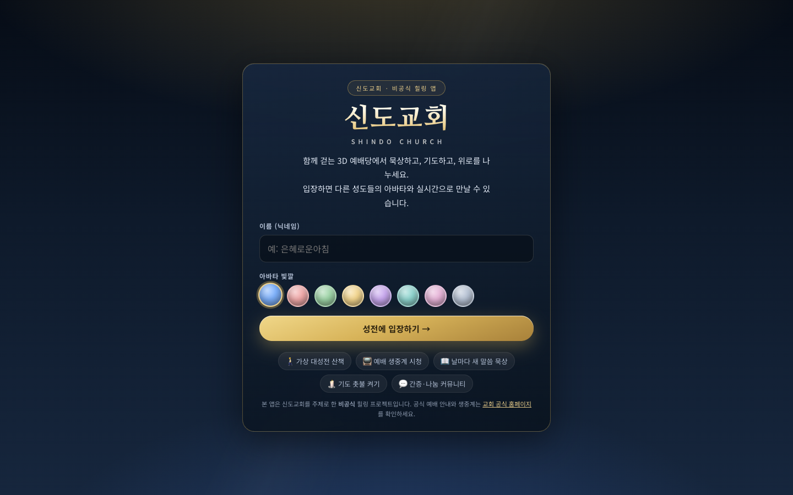
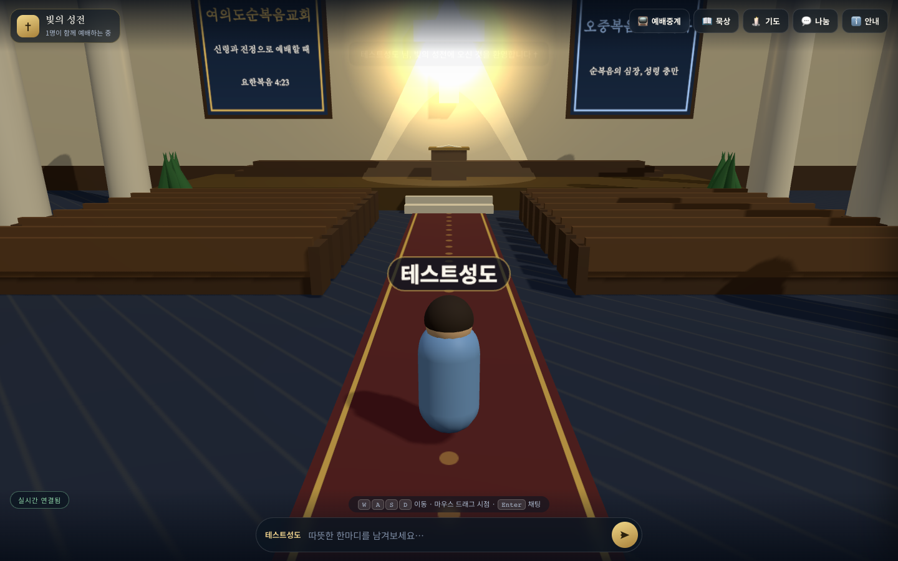
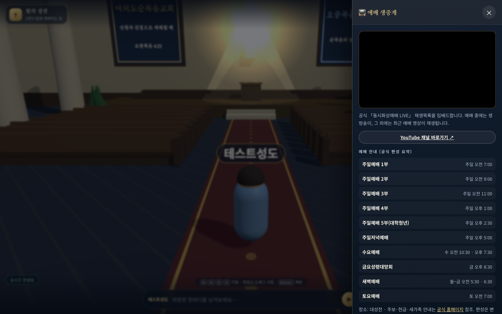
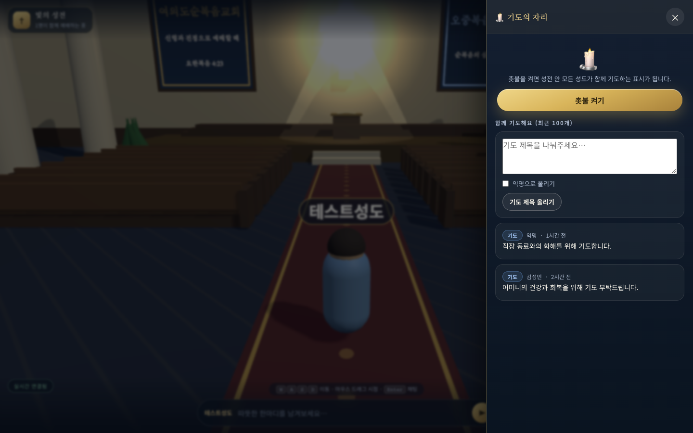
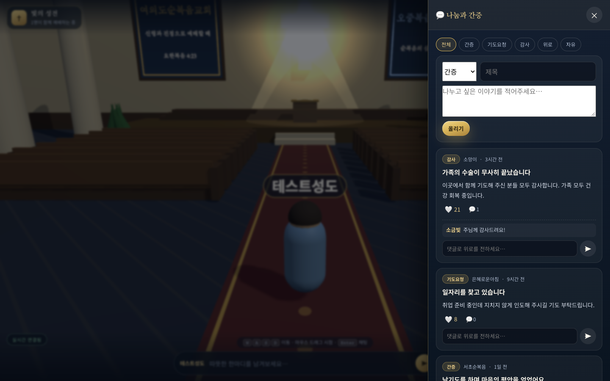

# 빛의 성전 (Light Sanctuary) ✝

여의도순복음교회를 테마로 한 **웹 3D 힐링 공간**. 링크 하나로 입장해 가상 대성전을 함께 걸으며, 예배 생중계를 보고, 말씀을 묵상하고, 기도 촛불을 켜고, 위로를 나눕니다.

> ⚠️ 본 프로젝트는 **비공식** 테마 앱입니다. 공식 예배 안내·생중계는 [교회 공식 채널](https://yfgc.fgtv.com)을 이용하세요.




## 빠른 시작

```bash
npm install
npm start          # http://localhost:8787
```

브라우저에서 http://localhost:8787 접속 → 닉네임 입력 → 「성전에 입장하기」.

여러 명이 함께 보려면 같은 네트워크(또는 배포 URL)로 접속하세요. 모든 접속자가 서로의 아바타를 실시간으로 봅니다.

## 스크립트

| 명령 | 설명 |
|---|---|
| `npm start` | 서버 실행 (PORT 환경변수, 기본 8787) |
| `npm run dev` | `node --watch` 자동 재시작 |

## 구조

```
server/         Express + WebSocket(/ws) 서버
  index.js      API 라우트 + WS 룸 로직 (+ 보안 헤더/레이트리밋)
  store.js      저장소 팩토리 — DATABASE_URL 있으면 Neon/Lakebase Postgres(pg.Pool), 없으면 로컬 JSON
public/         빌드 없는 정적 클라이언트 (ES 모듈)
  index.html    입장 화면 + HUD + 사이드 패널 골
  js/main.js    three.js 씬/카메라/입력/WS/채팅/패널 오케스트레이션
  js/sanctuary.js  예배당 3D 빌드 (절차적 텍스처, 충돌체 반환)
  js/avatars.js 저폴리 아바타 + 이름표/말풍선 스프라이트
  js/panels.js  예배중계/묵상/기도/나눔/안내 패널 (escapeHtml)
docs/           PRD·아키텍처·의사결정·작업로그·스크린샷
```

## 주요 기능

- 🚶 3D 대성전 탐험 (WASD/방향키 이동, 마우스 드래그 시점, Shift 달리기)
- 👥 실시간 아바타 동기화 + 채팅(Enter) + 아바타 위 말풍선
- 📺 공식 예배 생중계 임베드 + 예배 시간표
- 📖 날짜별 말씀 묵상 + SOAP 가이드 + 로컬 묵상 노트
- 🕯️ 기도 촛불 (전원 동시) + 익명 기도 제목
- 💬 간증/감사/위로 나눔 (공감·댓글)





## 환경 변수

| 변수 | 기본값 | 설명 |
|---|---|---|
| `PORT` | `8787` | HTTP/WS 포트 |
| `DATABASE_URL` | _(없음)_ | Neon/Lakebase Postgres 풀링 연결 문자열. 없으면 로컬 `data/db.json` |
| `DATABASE_URL_UNPOOLED` | _(없음)_ | 스키마 마이그레이션용 직접 연결 (미설정 시 무시) |

`.env.local`은 git에 포함되지 않습니다(`.gitignore`). 로컬에서 `neon env pull`로 받은 변수를 쓰려면 그대로 두면 됩니다.

## 배포 (무료로 여러 명이 쓰게 하기)

**Neon(무료 Postgres) + Render(무료 Web Service)** 조합을 권장합니다.

1. 저장소를 GitHub에 push → Render Dashboard에서 **New → Web Service** 생성
2. Build: `npm install` / Start: `npm start` / Health check: `/api/health`
3. Environment variables에 `DATABASE_URL`(풀링)을 등록 — 로컬이면 `.env.local`을 참고
4. 무료 플랜은 15분 미사용 시 슬립 → 첫 방문은 지연될 수 있음. `render.yaml`을 커밋해두면 Blueprint로 재현 가능

데이터는 `DATABASE_URL`이 설정된 경우 Neon Postgres에 영구 저장됩니다. 무료 Render만으로는 파일시스템이 임시라 커뮤니티 글이 재시작 시 사라집니다.

상세 절차와 학생들에게 전달할 안내는 [docs/DEPLOY.md](docs/DEPLOY.md)를 참고하세요.

## 문서

- [PRD.md](PRD.md) — 제품 요구사항
- [docs/ARCHITECTURE.md](docs/ARCHITECTURE.md) — 구조·프로토콜·API
- [docs/DECISIONS.md](docs/DECISIONS.md) — 의사결정 기록(ADR)
- [docs/WORKLOG.md](docs/WORKLOG.md) — 작업 로그
- [docs/ISSUES.md](docs/ISSUES.md) — 알려진 이슈·백로그

## 검증

헤드리스 Chrome + Playwright로 스모크 검증 (입장 → 씬 렌더 → 패널 5종 → 채팅). `NO_CONSOLE_ERRORS` 확인.
자세한 절차는 [docs/ARCHITECTURE.md](docs/ARCHITECTURE.md#테스트--검증).

## 라이선스/고지

공식 로고·건물 외관을 복제하지 않은 오마주이며, "여의도순복음교회" 명칭은 테마 표기 목적입니다.
기도 제목·나눔 글은 서버 저장소(Neon Postgres, 또는 `DATABASE_URL`이 없으면 `data/db.json`)에 저장되므로 개인 식별정보를 적지 마세요.
